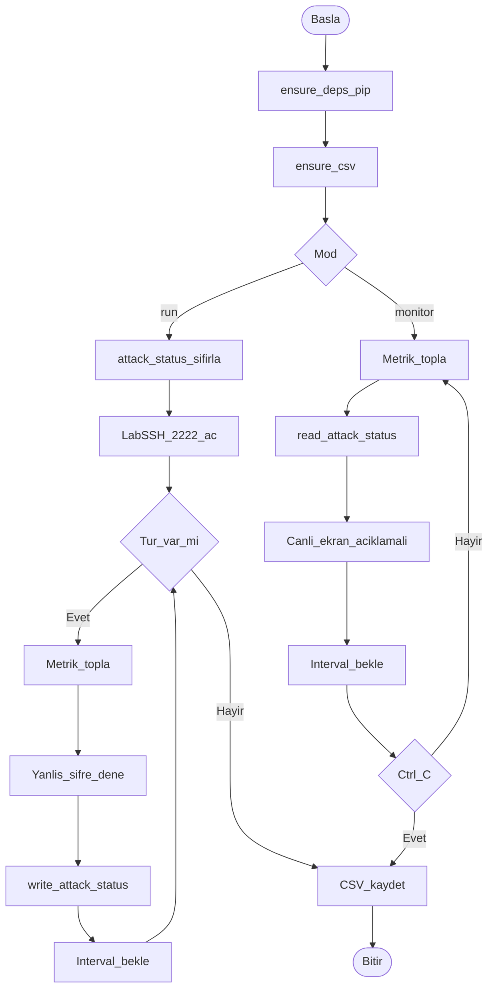

# BPMN — Ağ İzleme Ödev 1

Programın iş süreci: bağımlılık/CSV hazırlığı, CLI mod seçimi, ölçüm döngüsü, (isteğe bağlı) failed-login (`failed_login_count`), paylaşılan `attack_status.txt`, CSV kaydı.

## Süreç adımları

1. Başla → `ensure_deps` (eksik `psutil`/`paramiko` varsa pip kur)
2. `ensure_csv` (dosya yoksa başlıklı CSV oluştur)
3. CLI argüman (`--run` veya `--monitor`)
4. `--run`: `attack_status.txt` sıfırla → Lab SSH’ı `127.0.0.1:2222` aç
5. Tur / örnek: timestamp → arayüz → bağlantı → sistem
6. `--run` ise yanlış şifre SSH dene (`AUTH_FAILED`) → `write_attack_status`
7. `--monitor` ise `read_attack_status` (yan yana `--run` varsa fail/state) → canlı panel + `//` açıklama
8. Satırı bellekte tut; `INTERVAL` bekle
9. `--run`: turlar bitince CSV; `--monitor`: Ctrl+C ile CSV
10. Bitir

## Süreç diyagramı

## Görev–fonksiyon eşlemesi

| Görev | Fonksiyon |
|-------|-----------|
| Paket kurulumu | `ensure_deps` |
| CSV yoksa oluştur | `ensure_csv` |
| Lab SSH | `start_lab_ssh` / `LabSSH` |
| Metrik | `build_row` + collect_* |
| Atak | `attempt_ssh_login` |
| Atak durumunu yaz | `write_attack_status` |
| Atak durumunu oku | `read_attack_status` |
| Canlı ekran | `print_live` |
| Kayıt | `export_csv` |
| Modlar | `mode_run` / `mode_monitor` |
