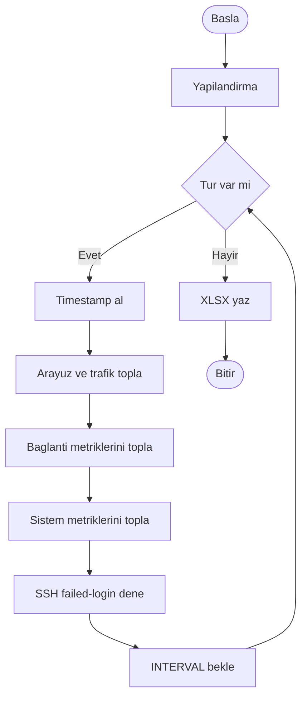

# BPMN — İzleme Süreci

Bu doküman, SSH localhost ağ izleme programının iş sürecini BPMN benzeri adımlarla gösterir.

## Süreç özeti

1. Program başlar (Start Event)
2. Yapılandırma okunur (host, port, kullanıcı, aralık, tur sayısı)
3. Ölçüm döngüsü başlar (Loop)
4. Timestamp alınır
5. Arayüz/trafik metrikleri toplanır
6. Bağlantı metrikleri toplanır
7. Sistem metrikleri toplanır
8. Localhost SSH yanlış giriş denemesi yapılır
9. Tur kaldıysa bekleme (Timer) → döngüye dön
10. Turlar bitince XLSX yazılır (ölçüm + özet)
11. Süreç sonlanır (End Event)

## Mermaid BPMN-benzeri akış

## Görev sorumlulukları

| Görev | Fonksiyon | Açıklama |
|-------|-----------|----------|
| Timestamp | `get_timestamp` | Zaman damgası |
| Arayüz/trafik | `collect_interface_metrics` | Bayt, paket, hız |
| Bağlantı | `collect_connection_metrics` | Port, durum, sayaçlar |
| Sistem | `collect_system_metrics` | CPU, bellek, ping |
| SSH denemesi | `attempt_ssh_login` | Auth/connect sonucu |
| Kayıt | `export_xlsx` | 2 sayfalı XLSX |
| Orkestrasyon | `main` | Döngü ve hata yönetimi |
