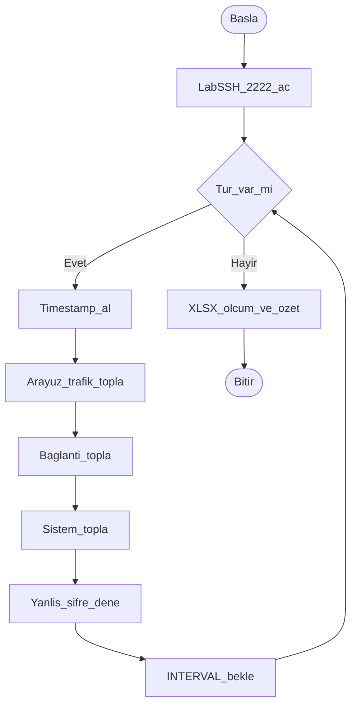

# BPMN — Ağ İzleme Ödev 1

Programın iş süreci: ölçüm döngüsü, failed-login denemesi, XLSX kaydı.

## Süreç adımları

1. Başla
2. Lab SSH’ı `127.0.0.1:2222` üzerinde aç (`start_lab_ssh`)
3. Tur kaldı mı?
4. Evet: timestamp al
5. Arayüz ve trafik metriklerini topla
6. Bağlantı metriklerini topla
7. Sistem metriklerini topla (CPU, bellek, ping)
8. Yanlış şifre ile SSH dene (`AUTH_FAILED` beklenir)
9. Satırı bellekte tut; `INTERVAL` kadar bekle; 3. adıma dön
10. Hayır: `export_xlsx` — Sayfa1 ölçüm, Sayfa2 özet
11. Bitir

## Süreç diyagramı

## Görev–fonksiyon eşlemesi

| Görev | Fonksiyon |
|-------|-----------|
| Lab SSH | `start_lab_ssh` / `LabSSH` |
| Timestamp | `get_timestamp` |
| Arayüz/trafik | `collect_interface_metrics` |
| Bağlantı | `collect_connection_metrics` |
| Sistem | `collect_system_metrics` |
| Failed-login | `attempt_ssh_login` |
| Kayıt | `export_xlsx` |
| Orkestrasyon | `main` |
