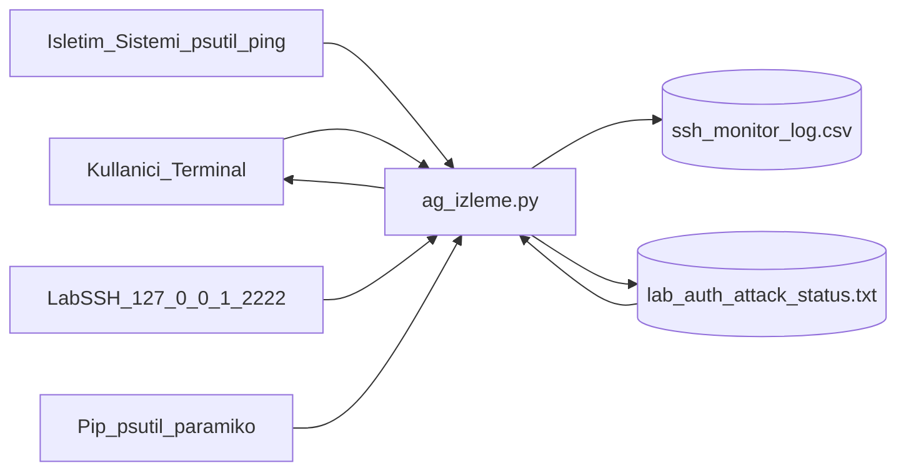
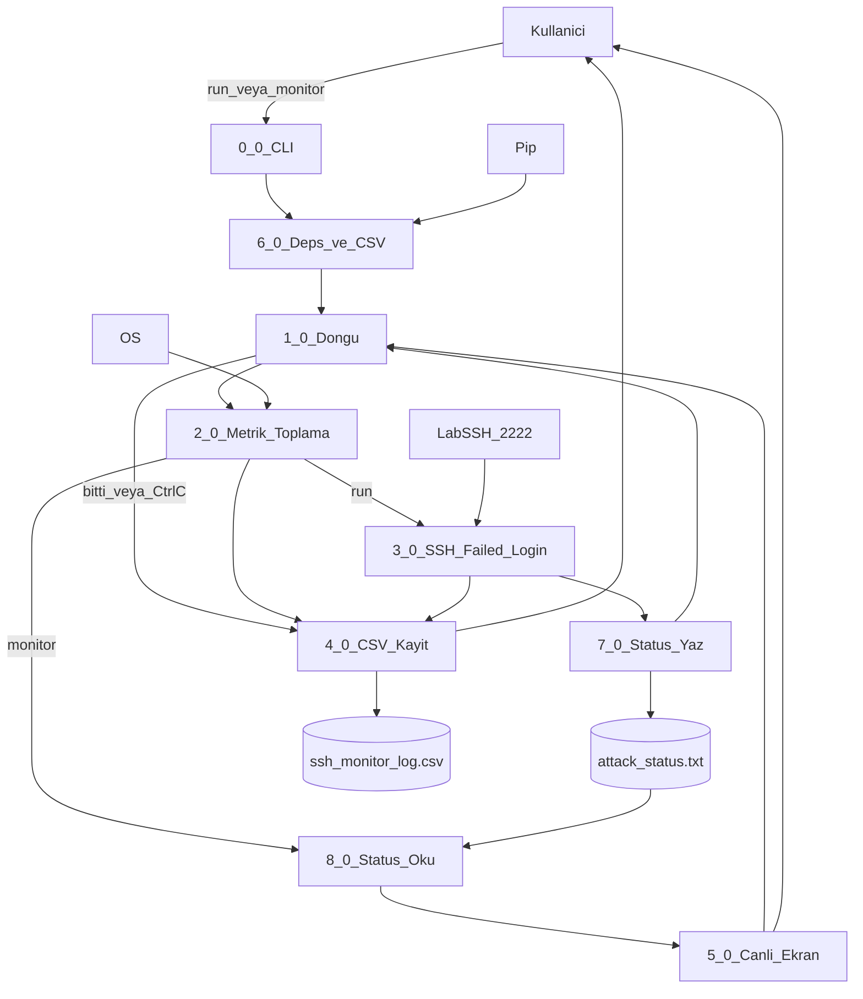

# DFD — Ağ İzleme Ödev 1

## Seviye 0 (bağlam)

- Kullanıcı `python3 ag_izleme.py --run` veya `--monitor` ile başlatır.
- İlk çalıştırmada eksik paketler pip ile kurulur (`requirements.txt` yok).
- CSV yoksa program başlık satırıyla oluşturur.
- Program OS’tan arayüz, bağlantı, CPU, bellek, ping alır.
- `--run` lab SSH’a yanlış kimlik gönderir; `AUTH_FAILED` döner ve `lab_auth/attack_status.txt` güncellenir.
- `--monitor` atak yapmaz; yan yana `--run` varsa status dosyasından `failed_login_count` / state okur.
- Sonuç `ssh_monitor_log.csv` dosyasına yazılır; monitor’da canlı terminal + `//` açıklama vardır (21 alan: timestamp + 20 değişken).

## Seviye 1 (süreçler)

| No | Süreç | Girdi | Çıktı |
|----|--------|--------|--------|
| 0.0 | CLI | `--run` / `--monitor` | mod seçimi |
| 6.0 | Deps + CSV | eksik paket / dosya yok | kurulu paket, başlıklı CSV |
| 1.0 | Döngü | tur / Ctrl+C | ölçüm tetikleri |
| 2.0 | Metrik toplama | OS sayaçları | 20 değişken |
| 3.0 | SSH denemesi | yanlış şifre | state, setup_time, fail |
| 7.0 | Status yaz | fail, state, setup | `attack_status.txt` |
| 8.0 | Status oku | `attack_status.txt` | fail/state (monitor) |
| 4.0 | CSV kayıt | satırlar | `ssh_monitor_log.csv` |
| 5.0 | Canlı ekran | satır | terminal paneli + `//` not |
