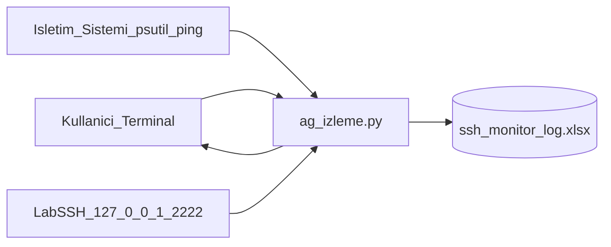
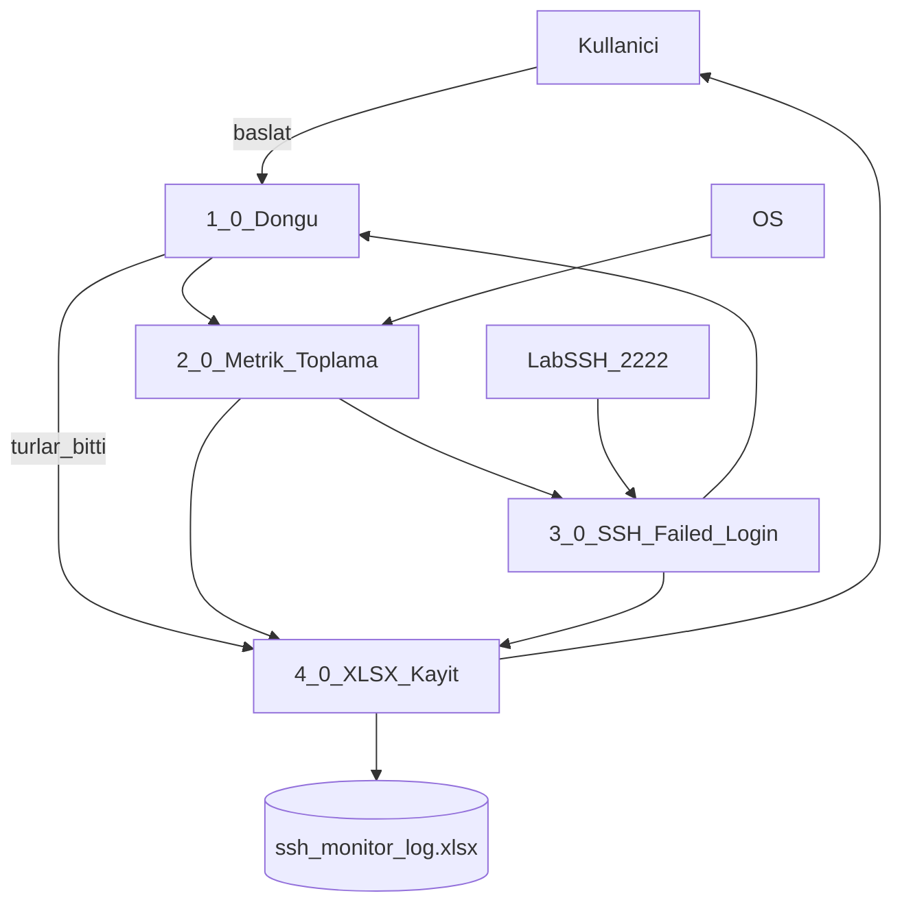

# DFD — Ağ İzleme Ödev 1

## Seviye 0 (bağlam)

- Kullanıcı programı çalıştırır; tur özetini terminalde görür.
- Program işletim sisteminden arayüz, bağlantı, CPU, bellek ve ping alır.
- Program lab SSH’a yanlış kimlik bilgisi gönderir; `AUTH_FAILED` döner.
- Sonuç iki sayfalı XLSX’e yazılır.

## Seviye 1 (süreçler)

| No | Süreç | Girdi | Çıktı |
|----|--------|--------|--------|
| 1.0 | Döngü | tur sayısı, aralık | ölçüm tetikleri |
| 2.0 | Metrik toplama | OS sayaçları | arayüz, bağlantı, sistem değişkenleri |
| 3.0 | SSH denemesi | host, user, yanlış şifre | state, setup_time, failed_login_count |
| 4.0 | XLSX kayıt | birleşik satırlar | Sayfa1 ölçüm, Sayfa2 özet |

## Veri akışları

1. OS → 2.0: bayt, paket, bağlantı, CPU, bellek, ping
2. Lab SSH → 3.0: auth reddi
3. 2.0 + 3.0 → 4.0: timestamp + 20 değişken
4. 4.0 → kullanıcı: `ssh_monitor_log.xlsx` ve terminal satırı
