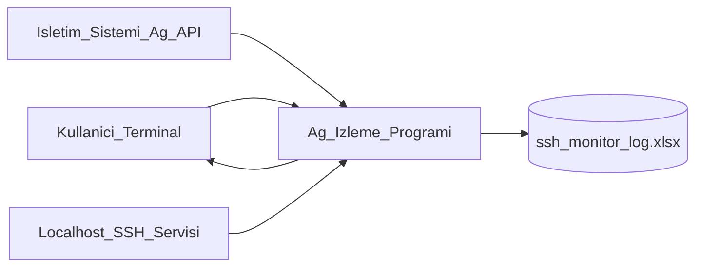
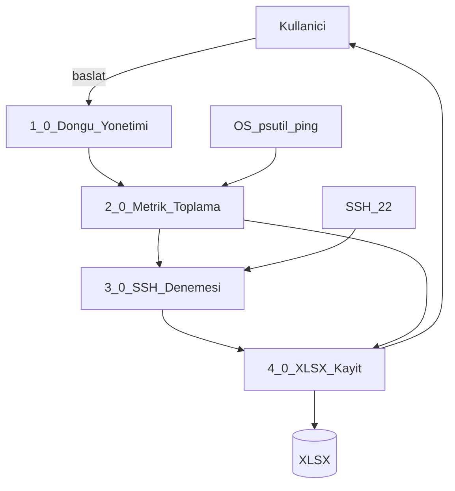

# DFD — Veri Akış Diyagramı

## Seviye 0 (Bağlam)

- Kullanıcı programı başlatır ve terminal özetini görür.
- Program işletim sisteminden ağ/sistem metriklerini alır.
- Program localhost SSH’a giriş denemesi gönderir / yanıt alır.
- Sonuçlar XLSX veri deposuna yazılır (2 sayfa).

## Seviye 1 (Süreçler)

### Süreç açıklamaları

| No | Süreç | Girdi | Çıktı |
|----|-------|-------|-------|
| 1.0 | Döngü yönetimi | Tur sayısı, aralık | Ölçüm tetikleri |
| 2.0 | Metrik toplama | OS sayaçları | 19 değişken (+ssh sonrası 20.) |
| 3.0 | SSH denemesi | host/user/yanlış şifre | setup_time, failed_login, state |
| 4.0 | XLSX kayıt | Birleşik satırlar | Ölçüm + Özet sayfaları |

## Veri akışları (kısa)

1. OS → Metrik toplama: bytes, packets, connections, CPU, memory, ping
2. SSH servisi → SSH denemesi: auth/connect sonucu
3. Metrik + SSH sonucu → XLSX: timestamp + 20 değişken + özet
4. Program → Kullanıcı: tur özeti (state, fail, cpu, rate)
