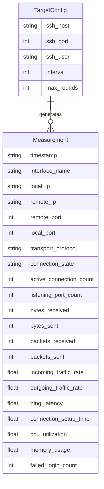

# ERD — Veri Modeli

Program veritabanı kullanmaz; kalıcı depolama tek XLSX dosyasıdır (ölçüm + özet sayfaları). ERD, bu mantıksal modeli gösterir.

## Varlıklar

### Measurement (ölçüm kaydı)

Her döngü turunda bir satır üretilir.

| Alan | Tip | Açıklama |
|------|-----|----------|
| timestamp | datetime/string | Birincil zaman anahtarı (satır kimliği ile birlikte) |
| interface_name | string | Ağ arayüzü |
| local_ip | string | Yerel IP |
| remote_ip | string | SSH hedef IP |
| remote_port | integer | SSH port (22) |
| local_port | integer | İstemci portu |
| transport_protocol | string | TCP/UDP |
| connection_state | string | AUTH_FAILED / CONNECT_FAILED / ... |
| active_connection_count | integer | Etkin bağlantı sayısı |
| listening_port_count | integer | Dinleyen port sayısı |
| bytes_received | integer | Alınan bayt |
| bytes_sent | integer | Gönderilen bayt |
| packets_received | integer | Alınan paket |
| packets_sent | integer | Gönderilen paket |
| incoming_traffic_rate | float | Gelen hız (B/s) |
| outgoing_traffic_rate | float | Giden hız (B/s) |
| ping_latency | float | Gecikme (ms) |
| connection_setup_time | float | SSH deneme süresi (ms) |
| cpu_utilization | float | CPU % |
| memory_usage | float | Bellek MB |
| failed_login_count | integer | Kümülatif başarısız giriş |

### TargetConfig (yapılandırma — kod içi)

| Alan | Tip | Açıklama |
|------|-----|----------|
| ssh_host | string | 127.0.0.1 |
| ssh_port | integer | 22 |
| ssh_user | string | labuser |
| interval | integer | ölçüm aralığı (sn) |
| max_rounds | integer | tur sayısı |

## İlişki diyagramı

## Anahtarlar

- Mantıksal PK: (`timestamp`, tur sırası / satır numarası)
- FK benzeri bağ: her `Measurement.remote_ip/remote_port` → `TargetConfig.ssh_host/ssh_port`
