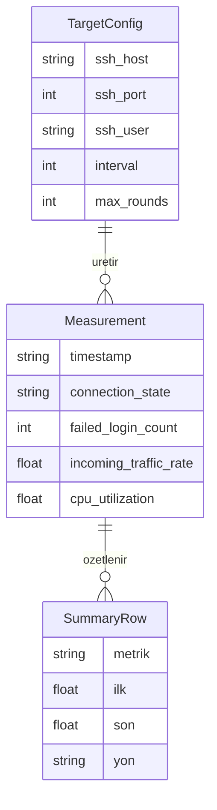

# ERD — Ağ İzleme Ödev 1

Veritabanı yoktur. Kalıcı depolama `ssh_monitor_log.xlsx` dosyasıdır.

- Sayfa `ssh_monitor_log`: her tur bir ölçüm satırı
- Sayfa `Ozet`: ilk–son farkı, yön (ARTIS/AZALIS/SABIT), anlam

## Varlık: Measurement

Timestamp + 20 izleme değişkeni.

| Alan | Tip | Açıklama |
|------|-----|----------|
| timestamp | string | Ölçüm zamanı |
| interface_name | string | Ağ arayüzü |
| local_ip | string | Yerel IP |
| remote_ip | string | 127.0.0.1 |
| remote_port | integer | 2222 |
| local_port | integer | İstemci portu |
| transport_protocol | string | TCP |
| connection_state | string | AUTH_FAILED / CONNECT_FAILED |
| active_connection_count | integer | Etkin bağlantı |
| listening_port_count | integer | Dinleyen port |
| bytes_received | integer | Alınan bayt |
| bytes_sent | integer | Gönderilen bayt |
| packets_received | integer | Alınan paket |
| packets_sent | integer | Gönderilen paket |
| incoming_traffic_rate | float | Gelen B/s |
| outgoing_traffic_rate | float | Giden B/s |
| ping_latency | float | ms |
| connection_setup_time | float | SSH deneme ms |
| cpu_utilization | float | CPU % |
| memory_usage | float | MB |
| failed_login_count | integer | Kümülatif başarısız giriş |

## Varlık: SummaryRow

| Alan | Tip | Açıklama |
|------|-----|----------|
| metrik | string | Değişken adı |
| ilk | float | İlk tur |
| son | float | Son tur |
| fark | float | Mutlak fark |
| yon | string | ARTIS / AZALIS / SABIT |
| anlam | string | Atak izi açıklaması |

## Varlık: TargetConfig (kod sabitleri)

20 değişkene dahil değildir.

| Alan | Değer |
|------|--------|
| ssh_host | 127.0.0.1 |
| ssh_port | 2222 |
| ssh_user | labuser |
| interval | 2 sn |
| max_rounds | 10 |

## İlişki

Mantıksal anahtar: ölçüm satırı için `timestamp` + tur sırası.  
`Measurement.remote_ip` / `remote_port` yapılandırmadaki host/port ile aynıdır.
